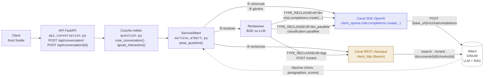

# MQC vers Albert : parcours d'un appel

Depuis les deux routes de `src/api/api_conversation.py` (`POST /api/conversation/` et
`POST /api/conversation/{id_conversation}`)
jusqu'aux appels sortants vers Albert : via le SDK OpenAI d'un côté, l'API REST « classique » d'Albert de l'autre.
Les deux routes convergent immédiatement vers la même logique, `ServiceAlbert.pose_question()`.

Les références citent des noms de fonctions et de classes, pas des numéros de ligne, qui deviennent faux à chaque modification.

## Le détail du flux dans pose_question()

### ① Reformulation de la question : SDK OpenAI

`ReformulateurDeQuestion.reformule()` (`src/question/reformulateur_de_question.py`) reconstruit la question à partir de l'historique de conversation, puis l'envoie au
modèle de reformulation (`ALBERT_MODELE_REFORMULATION`) via `recupere_propositions()` du client Albert.

Si la réponse est `QUESTION_NON_COMPRISE`, le flux s'arrête ici : `ServiceAlbert.pose_question()` renvoie une `ViolationQuestionNonComprise` sans
qu'aucun autre appel ne soit fait.

### ② Recherche des paragraphes pertinents : REST

`ServiceAlbert.recherche_paragraphes()` (`src/services/service_albert.py`) appelle `ClientAlbertApi.recherche()` (`src/infra/albert/client_albert.py`), qui envoie `POST /search` sur la collection ANSSI. La recherche est `hybrid` ou `semantic` selon `ALBERT_UTILISE_RECHERCHE_HYBRIDE`.

### ②b Recherche « jeopardy » (optionnelle, si `JEOPARDY_ACTIVE=true`)

`ServiceAlbert.__recherche_dans_collection_jeopardy()` interroge une seconde collection (`COLLECTION_ID_ANSSI_LAB_JEOPARDY`) par `recherche_jeopardy()`, puis récupère pour chaque résultat le chunk complet par `recherche_chunk_par_id()` (`GET /documents/{id_document}/chunks/{id_chunk}`). Les résultats sont fusionnés et dédoublonnés avec ceux de l'étape ②.

### ②c Enrichissement des paragraphes et contexte des guides MSC

Les paragraphes sont enrichis par la stratégie `ParPagePrecedenteEtSuivante` (`src/services/strategie_enrichissement_paragraphes.py`), qui s'appuie sur `recupere_chunks_document()` pour compléter chaque paragraphe avec les pages précédente et suivante.
`ServiceAlbert.pose_question()` récupère ensuite les métadonnées des guides sur `GET {URL_MSC}/api/guides`, puis `associe_contexte_msc()` (`src/services/contexte_documents.py`) rattache à chaque paragraphe le contexte de son guide.

### ③ Reclassement des paragraphes : BGE, LLM ou LLM parallèle

`ServiceAlbert.__effectue_reclassement()` appelle le reclasseur choisi par `TYPE_RECLASSEUR` (`src/services/fabrique_reclasseur.py`) :

- `bge` : `ReclasseurBGE` (`src/question/reclassement/reclasseur_bge.py`) envoie les candidats à `ClientAlbertApi.reclasse()`, soit `POST /rerank`.
- `llm` : `ReclasseurLLM` (`src/question/reclassement/reclasseur_llm.py`) interroge le modèle LLM via le SDK OpenAI.
- `llm_parallele` : `ReclasseurLLMEnParallele` (`src/services/reclasseur_llm_en_parallele.py`) classe les candidats par lots de `ALBERT_RECLASSEMENT_TAILLE_LOT` éléments, lots exécutés en parallèle par le coordinateur (`src/services/coordinateur_reclassement_parallele.py`).

Les résultats sont ensuite filtrés sur les « réponses maîtrisées » (FAQ) : `_filtre_reponses_maitrisees()` ne garde que celles dont le score atteint `SEUIL_REPONSE_MAITRISEE`.

### ④ Génération de la réponse : SDK OpenAI

`ServiceAlbert.__effectue_recuperation_propositions()` injecte les paragraphes retenus dans le prompt système, avec l'historique de conversation limité à
`ALBERT_TAILLE_FENETRE_HISTORIQUE` échanges, puis appelle `recupere_propositions()` avec le modèle de réponse (`ALBERT_MODELE`).

### ⑤ Analyse de la réponse : local (aucun appel réseau)

`ServiceAlbert._recupere_reponse_paragraphes_et_violation()` détecte les marqueurs texte (`ERREUR_IDENTITÉ`, `ERREUR_THÉMATIQUE`, `ERREUR_MALVEILLANCE`, `ERREUR_MECONNAISSANCE`)
pour transformer la réponse en violation si besoin.

### ⑥ Retour au client : local

La conversation est sauvegardée en base, l'événement est consigné dans le journal, puis `api_conversation.py` renvoie
une `200/201 JSON`, ou une `HTTPException` en cas d'erreur.

Ce retour est assuré par `cree_conversation()` et `ajoute_interaction()` (`src/question/question.py`), appelées par les fonctions de route `route_initie_conversation` et `route_conversation_ajoute_interaction` (`src/api/api_conversation.py`).

## Erreurs de communication avec Albert

| Exception | Déclenchée par | Type d'erreur | Code HTTP |
|---|---|---|---|
| `ErreurRechercheDocuments` | échec de `POST /search` (étape ②) | COMMUNICATION_ALBERT | **500** |
| `ErreurCommunicationAlbert` | échec de `POST /rerank` avec le reclasseur BGE (étape ③, `TYPE_RECLASSEUR=bge`) | COMMUNICATION_ALBERT | **500** |
| `ErreurCommunicationModele` | classe de base : timeout ou erreur de connexion sur `chat.completions.create` | COMMUNICATION_ALBERT | **500** |
| `ErreurCommunicationModeleReformulation` | échec de `chat.completions.create` à l'étape ① (`reformulateur_de_question.py`) | COMMUNICATION_ALBERT | **500** |
| `ErreurCommunicationModeleReclassement` | échec de `chat.completions.create` à l'étape ③ avec `TYPE_RECLASSEUR=llm` (`ReclasseurLLM`) ou `llm_parallele` (`ReclasseurLLMEnParallele`) | COMMUNICATION_ALBERT | **500** |
| `ErreurCommunicationModeleGeneration` | échec de `chat.completions.create` à l'étape ④ (`ServiceAlbert.__effectue_recuperation_propositions()`) | COMMUNICATION_ALBERT | **500** |
| Exception générique | toute autre erreur imprévue dans le flux | INCONNU | **422** |
| `ResultatConversationInconnue` | `id_conversation` absent de la base (route `POST /api/conversation/{id}` uniquement) | aucun | **404** |
